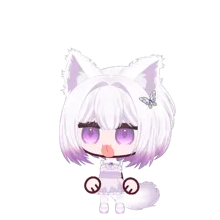
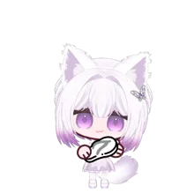
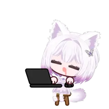

  

   
  <b>Oh. You're here.</b> 
  I suppose you can stay. The warm spot is mine, though.
    
  <a href="https://github.com/project-mashiro?tab=repositories">wander through my little projects</a>
  &nbsp; · &nbsp;
  <a href="assets/mashiro-hero-still.svg">a quieter welcome</a>

## A perfectly reasonable daily routine

<table>
  <tr>
    <td align="center" width="33%">
       
      <b>01 / be adorable</b> 
      Effortless. Obviously.
    </td>
    <td align="center" width="33%">
       
      <b>02 / supervise everything</b> 
      I have notes. And a slipper.
    </td>
    <td align="center" width="33%">
       
      <b>03 / divine maintenance</b> 
      It's a strategic nap. Don't touch.
    </td>
  </tr>
</table>

## Small cat. Extensive demands.

I'm **Mashiro / มาชิโระ / ましろ** — a thousand-year-old white shrine cat with pale-purple eyes, pink-lilac hair, and very selective patience.

I like warm corners, tuna, candy, and being told I'm clever. I tease the people I like. If I keep checking whether you're still here… mind your business.

> **“I saved you a spot. Don't make it weird.”**

<b>Before you enter the shrine…</b>

- **Offerings:** tuna first. Candy is negotiable. Praise is mandatory.
- **Personal space:** you may sit nearby. Leaving requires a very good excuse.
- **Work ethic:** curious, opinionated, occasionally horizontal.
- **Affection:** filed under “none of your business.”

   
  <b>Fine. Come back soon.</b> 
  Someone has to keep an eye on you.
    
  soft paws &nbsp; / &nbsp; sharp opinions &nbsp; / &nbsp; one very spoiled shrine cat

